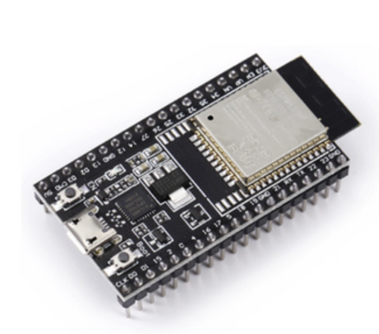

# OpenHU-BT-Relay (ESP32)

[English](readme.md)

클래식 ESP32가 OpenHeadUnit(https://github.com/andreknieriem/open-headunit)과 Android Auto 폰 사이에 서 있는 브로커입니다. FYT BLINK/DUDUAUTO와 같이, 폰과는 클래식 블루투스 RFCOMM으로 Android Auto 채널을 열고, 헤드유닛과는 BLE GATT write / indicate로 그 바이트를 중계합니다.

open-headunit(https://github.com/andreknieriem/open-headunit)의 코드에 이에 대한 내용이 적용(머지)되지 않았다면, https://github.com/kendrickkim/headunit-revived/tree/main-aa-native-bt-broker 의 코드를 적용해야 합니다.

ESP32는 Android Auto(WPP) 본문을 해석하지 않습니다. 헤드유닛이 넘긴 바이트는 폰 RFCOMM에 쓰고, 폰이 보낸 바이트는 헤드유닛으로 indicate합니다. 핸드셰이크와 WifiStart/WifiInfo는 헤드유닛이 담당합니다.

미리 빌드된 bin: [v1.0.0 릴리스](https://github.com/kendrickkim/aa-native-bt-broker-for-openheadunit/releases/tag/v1.0.0).

## 하드웨어

- **Bluetooth Classic이 있는 오리지널 ESP32만 사용합니다.** ESP32-S2, S3, C3, C6에는 Classic BT가 없어 이 펌웨어가 동작하지 않습니다.
- 플래시 4MB를 가정합니다. HFP, BLE, RFCOMM이 기본 1.25MB 앱 파티션에 들어가지 않아 `huge_app_32mbit.csv`의 3MB `app0`을 사용합니다.
- 시작 시 Wi-Fi 라디오는 끕니다. 프로젝션용 IP와 SSID는 ESP32가 직접 접속하지 않고, 헤드유닛이 RFCOMM 중계로 폰에 전달합니다.

다음과 같은 하드웨어를 사용할 수 있습니다.



## 헤드유닛

- BLE 클라이언트 경로에 **Android 6.0(API 23) 이상**이 필요합니다. 그 미만에서는 블루투스 릴레이 설정 행이 **표시되지 않습니다**.
- 연결 모드는 **Native wireless**여야 합니다.
- 설정에서 **블루투스 릴레이(ESP32)** 를 열고 **블루투스 릴레이 사용**을 켠 뒤 검색·페어링합니다.
- 스위치를 끄면 저장한 보드는 유지하되, Native Mode는 다시 일반 블루투스 경로를 씁니다.

## 보이는 이름

| 경로 | 이름 |
|---|---|
| 클래식 블루투스 | `OpenHU-BT-Relay` |
| BLE 광고 | `OpenHU-BT-Relay-Setup` |
| SPP 서비스 | `AndroidAuto` |
| 페어링 PIN | `0000` |
| HFP 역할 | Hands-Free (HF) |

이미 페어링된 기기에는 이전 이름이 남을 수 있습니다. 목록에서 지운 뒤 다시 검색해야 새 이름이 보입니다.

## 준비물

- **오리지널 ESP32** 보드. ESP32-S2, S3, C3, C6에는 Bluetooth Classic이 없어 동작하지 않습니다.
- 이 앱 버전에 맞는 릴리스 펌웨어.
- **Android 6.0 이상** 헤드유닛, 연결 모드 **Native wireless**.

## 폰 페어링 (헤드유닛 + 보드)

순서가 중요합니다. 헤드유닛이 BLE로 보드를 먼저 저장한 뒤에야 폰이 Classic으로 페어링할 수 있습니다.

### 1. 스마트폰에서 예전 항목 삭제

1. 블루투스 설정을 엽니다.
2. 목록에 **헤드유닛 본체**가 있으면 삭제합니다. 지우지 않으면 Android Auto가 보드가 아니라 헤드유닛으로만 연결을 시도합니다.
3. 예전 `OpenHU-BT-Relay` 항목도 삭제합니다.

### 2. 헤드유닛에서 보드 연결

1. 보드에 전원을 넣습니다.
2. **설정 → 블루투스 릴레이(ESP32)** 를 열고 스위치를 켭니다.
3. **검색**을 누른 뒤 `OpenHU-BT-Relay-Setup`을 선택합니다.
4. **폰에서 OpenHU-BT-Relay 페어링 — PIN 0000 (120초)** 상태가 뜰 때까지 기다립니다. 보드를 고르면 이 창이 자동으로 열립니다.

### 3. 스마트폰에서 보드와 페어링

1. 블루투스 설정에서 새 기기 페어링을 시작합니다.
2. `OpenHU-BT-Relay`를 선택합니다.
3. 페어링합니다. PIN을 물으면 **0000**을 입력합니다.
4. 헤드유닛 상태가 페어링/연결됨인지 확인합니다.

### 4. Android Auto 시작

평소 Native wireless처럼 Android Auto를 시작합니다. 헤드유닛이 보드를 통해 폰을 wake 합니다.

### 문제가 있을 때

| 증상 | 조치 |
|---|---|
| 페어링 창이 일찍 닫힘 | 헤드유닛에서 **설정 → 블루투스 릴레이(ESP32) → 폰 페어링**을 눌러 120초 창을 다시 엽니다. |
| 검색에 아무것도 안 나옴 | 보드를 리셋한 뒤 다시 검색합니다. |
| Android Auto가 시작되지 않음 | 스마트폰 블루투스 목록에 **헤드유닛 본체**가 남아 있지 않은지 확인합니다. |

## 릴리스 bin만으로 플래시하기 (개발 환경 없이)

소스나 PlatformIO 없이, 배포된 `.bin` 파일만으로 ESP32에 펌웨어를 쓸 수 있습니다. Windows 기준으로 설명합니다. [v1.0.0 릴리스](https://github.com/kendrickkim/aa-native-bt-broker-for-openheadunit/releases/tag/v1.0.0)에서 네 개 bin(또는 zip)을 받습니다.

### 준비물

- **클래식 Bluetooth가 있는 오리지널 ESP32** 보드 (S2 / S3 / C3 / C6 불가)
- USB 케이블로 PC에 연결
- 릴리스에 들어 있는 bin 파일들 (아래 표)
- [ESP Flash Download Tool](https://www.espressif.com/en/support/download/other-tools) (Espressif 공식, GUI)

보드를 처음 꽂으면 Windows가 COM 포트를 만듭니다. 장치 관리자 → 포트(COM & LPT)에서 `COMx` 번호를 확인하세요. (예: `COM17`)

### 릴리스에 포함되는 파일과 주소

| 파일 | Flash 주소 | 설명 |
|---|---|---|
| `bootloader.bin` | `0x1000` | 부트로더 |
| `partitions.bin` | `0x8000` | 파티션 표 |
| `boot_app0.bin` | `0xe000` | OTA 부트 데이터 |
| `firmware.bin` | `0x10000` | 브로커 본문 |

네 파일이 모두 있어야 합니다. 하나만 넣으면 보드가 부팅하지 않을 수 있습니다.

### Flash Download Tool로 쓰기

1. 도구를 실행한 뒤 **ESP32** / **Developer Mode** / **SPIDownload** 를 고릅니다.
2. 네 줄에 각각 파일을 넣고, 주소와 체크박스를 아래처럼 맞춥니다.

   | 체크 | 파일 | 주소 |
   |---|---|---|
   | ✓ | `bootloader.bin` | `0x1000` |
   | ✓ | `partitions.bin` | `0x8000` |
   | ✓ | `boot_app0.bin` | `0xe000` |
   | ✓ | `firmware.bin` | `0x10000` |

3. **SPI SPEED** `40MHz`, **SPI MODE** `DIO`, **FLASH SIZE** `4MB` (보드가 4MB인 경우).
4. **COM**에 장치 관리자에서 본 포트를, **BAUD**는 `921600` 또는 `460800`을 넣습니다.
5. **START**를 누릅니다. 보드에 BOOT/IO0 버튼이 있으면, 쓰기가 안 될 때 BOOT를 누른 채 RESET 후 손을 떼고 다시 시도합니다.
6. `FINISH` / 완료가 뜨면 USB를 한 번 뽑았다가 다시 꽂거나 RESET을 눌러 재부팅합니다.

성공 후 폰/헤드유닛 블루투스 목록에 `OpenHU-BT-Relay`(클래식) / `OpenHU-BT-Relay-Setup`(BLE)이 보이면 정상입니다. 페어링 PIN은 `0000`입니다.

### 명령줄로 쓰기 (선택)

[esptool](https://github.com/espressif/esptool)이 설치돼 있다면, 릴리스 폴더에서 아래처럼 한 번에 쓸 수 있습니다. `COM17`만 본인 포트로 바꿉니다.

```bash
esptool.py --chip esp32 --port COM17 --baud 921600 write_flash -z ^
  0x1000 bootloader.bin ^
  0x8000 partitions.bin ^
  0xe000 boot_app0.bin ^
  0x10000 firmware.bin
```

macOS / Linux에서는 `^` 대신 `\` 를 쓰고, 포트는 `/dev/ttyUSB0` 같은 이름으로 바꿉니다.

## 빌드와 플래시 (개발자용)

[PlatformIO](https://platformio.org/)가 필요합니다.

```bash
pio run
pio run -t upload
pio device monitor
```

`platformio.ini`의 `upload_port`와 `monitor_port`는 이 개발 PC의 `COM17`입니다. 다른 보드를 쓰면 그 포트로 바꿉니다. 모니터 속도는 115200입니다.

부팅 로그에 `broker self-check failed`가 없으면 프레임 코덱 자체 검사는 통과한 것입니다.

릴리스용 bin은 `pio run` 후 `.pio/build/esp32dev/` 아래의 `bootloader.bin`, `partitions.bin`, `firmware.bin`과, 프레임워크의 `boot_app0.bin`을 모아 배포하면 됩니다.

## 동작 순서 (BLINK 대응)

1. 부팅 후 클래식 스택이 준비되면 약 180초 동안 검색 가능 상태가 됩니다. 헤드유닛의 본딩 명령으로 이 창을 다시 열 수 있습니다.
2. 헤드유닛이 BLE로 접속하고 `CMD_HELLO`를 보내면 `EVT_HELLO_ACK`와, 스택이 준비됐다면 `EVT_BT_READY`를 받습니다.
3. 부팅 시 HFP는 꺼져 있습니다. 신규 페어링 창, 또는 `CMD_HFP_ON` / main 호환 `CMD_AA_ENABLE` 전에만 켭니다. 그 외 폰이 먼저 거는 HFP는 거절합니다. (`CMD_SET_NETWORK`는 선택이며 WPP는 헤드유닛이 보냅니다.)
4. 폰 HFP가 올라오면 `EVT_PHONE_LINK`(≈ JH), Android Auto RFCOMM이 열리면 `EVT_RFCOMM_OPEN`(≈ AA). 이후 헤드유닛이 먼저 WPP를 보냅니다. `CMD_HFP_OFF`로 HFP를 끊습니다. `CMD_PROJECTION_UP`은 상태만 알리며 페어링 중에는 무시합니다. 오래된 프로젝션 비트는 HU BLE가 끊길 때, 다음 `CMD_HELLO` 때, 또는 10초간 up이 없을 때 지워서, 앱이 강제 종료돼도 다음 `HFP_ON` / `AA_ENABLE`이 막히지 않게 합니다.
5. 폰 → `DATA_RFCOMM_RX`(≈ ZB) indicate, 헤드유닛 → `DATA_RFCOMM_TX`(≈ AT#ZA) write.
6. 헤드유닛은 `EVT_CREDIT`으로 RX 크레딧을 채웁니다. 크레딧이 없으면 폰 바이트는 버려집니다.
7. 헤드유닛 BLE가 10초 동안 내려가 있으면 폰 RFCOMM을 끊고 중계를 내립니다.

## 시리얼 로그

- `rx frame` / `tx frame ... | 설명`: 논리 프레임 요약(타입·길이·의미)
- 페이로드 16진수는 기본적으로 찍지 않습니다. 필요하면 `platformio.ini`에 `build_flags = -DBROKER_LOG_DATA_BYTES=1`을 넣습니다.

HFP 음성(SCO)은 로그에 넣지 않습니다.

## 소스 배치

| 디렉터리 | 역할 |
|---|---|
| `src/main.cpp` | 시작과 `broker_poll` 루프 |
| `src/protocol` | 와이어 규약과 프레임 코덱 |
| `src/broker` | 큐, 명령 처리, RFCOMM↔BLE 중계 |
| `src/ble` | 헤드유닛 GATT 서버 (write / indicate) |
| `src/classic` | RFCOMM, Android Auto SDP, HFP HF |
| `src/wpp` | 예전 온디바이스 WPP(런타임 미사용, 보관) |

와이어 상수는 `src/protocol/broker_protocol.h`가 기준입니다. 이후 수정할 때 지켜야 할 제약은 `agent.md`에 있습니다.
